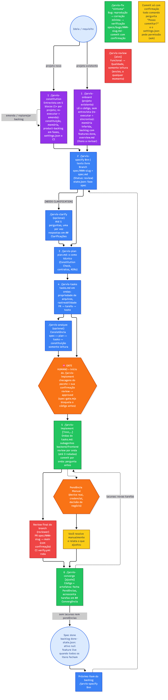

# Specnico

[](https://www.npmjs.com/package/specnico)
[](#licença)

Fluxo spec-driven **agnóstico de ferramenta** — para **Claude Code**, **GitHub
Copilot** e **Google AI Pro (Antigravity & Gemini CLI)** — com gate humano
mecânico, verificação com evidência, subagente `runner` para economia de tokens
e execução paralela em ondas.

---

## Por que

- Agentes de IA não conhecem seu projeto: sem contexto, inventam padrões, repetem
  perguntas e divergem do planejado. A **constituição** e a memória em
  `.specify/memory/` entregam só o que o agente não infere sozinho.
- "Está pronto" costuma ser autodeclaração. Aqui nenhum critério de aceite vira
  `[x]` sem a saída real de um comando de verificação; o que exige ação humana
  vira **Pendência Manual** rastreável.
- **Economia real de tokens:** comandos verbosos (`npm test`, `build`, `lint`,
  `type-check`) rodam no subagente **`runner`** (somente leitura + terminal,
  modelo econômico `haiku`/`flash`), trazendo para a thread principal apenas
  status, contagens e erros em `arquivo:linha`. Rotinas independentes rodam em
  paralelo numa única rodada.
- Implementar antes de aprovar não depende de boa vontade: o hook `spec-gate`
  **bloqueia** a edição dos arquivos da Spec ativa enquanto ela está em `review`,
  e a aprovação é um gate humano no início do `/jarvis-implement`.
- **Uma fonte, três ecossistemas:** `AGENTS.md` + padrão aberto Agent Skills +
  núcleo puro de hooks em `.specify/hooks/core/`, adaptados automaticamente pelo
  CLI para **Claude Code**, **GitHub Copilot** e **Google AI Pro**.

Inspirado no [Spec Kit](https://github.com/github/spec-kit), com aprovação
humana, hooks mecânicos e isolamento de contexto via subagentes.

---

## Instalação

**Pré-requisitos:** Node ≥ 18, git e ao menos um dos assistentes suportados
(**Claude Code**, **GitHub Copilot** ou **Google AI Pro — Antigravity / Gemini
CLI**). O `gh` (GitHub CLI) é opcional, usado só para abrir o PR no fim da
implementação.

```bash
cd seu-projeto

# Interativo (pergunta quais assistentes você usa; em CI/não-interativo usa claude):
npx specnico

# Ou informe os targets diretamente:
npx specnico --target claude
npx specnico --target copilot
npx specnico --target gemini              # Antigravity + Gemini CLI
npx specnico --target claude,copilot
npx specnico --target all                 # instala os três sem conflito
```

Em seguida, abra seu assistente e rode:
- **Projeto novo:** `/jarvis-constitution`
- **Projeto existente (sem Specnico):** `/jarvis-onboard`

O `/jarvis-onboard` lê o código em vez de entrevistar: preenche a memória e o
backlog (features entregues como `done`) e grava o resumo
`.specify/memory/overview.md`. Ao fim da instalação, o próprio CLI indica qual
dos dois comandos usar (`Próximo:`), conforme o diretório já tenha código ou não.

O `npx specnico` nunca sobrescreve arquivos que já existem. Se o projeto já tem
o Spec Kit (arquivo `init-options.json` em `.specify`), o CLI avisa: os dois usam
`.specify/memory/constitution.md`.

### O que é instalado por target

**Sempre instalado (compartilhado entre todos os assistentes):**

```text
AGENTS.md                   ← instruções canônicas: tiers de contexto, papéis, runner, paralelismo, comandos
.specify/
  memory/                   ← dado do projeto: constituição, produto, backlog, arquitetura, convenções, decisões
  templates/ packs/ workflows/   ← processo (atualizado pelo --upgrade)
  hooks/                    ← núcleo puro dos hooks + adapters Copilot e Gemini/Antigravity
  .specnico-version  .specnico-config.json
specs/
  README.md                 ← uma pasta por Spec: specs/NNN-slug/
```

**Por assistente (`--target`):**

| Target | Arquivos gerados | Observações |
|---|---|---|
| `claude` | `.claude/{CLAUDE.md,README.md,settings.example.json}`, `.claude/skills/`, `.claude/agents/` (`runner` em `haiku`), `.claude/hooks/` | `CLAUDE.md` importa `@../AGENTS.md`; hooks chamam `.specify/hooks/core/` |
| `copilot` | `.github/copilot-instructions.md`, `.github/skills/`, `.github/agents/*.agent.md`, `.github/hooks/specnico.json` | `runner` e `reviewer` sem ferramenta `edit` |
| `gemini` | `GEMINI.md`, `.agents/skills/`, `.agents/hooks.json`, `.gemini/agents/` (`runner` em `gemini-2.5-flash`), `.gemini/settings.example.json` | Cobre **Antigravity** (`.agents/`) e **Gemini CLI** (`.gemini/` + `GEMINI.md`) |

---

## Atualização

```bash
npx specnico --check                        # versão instalada, targets ativos e drift local (somente leitura)
npx specnico@latest --upgrade               # atualiza o harness de todos os targets configurados
npx specnico@latest --upgrade --target +copilot   # acrescenta um novo assistente ao projeto existente
```

O `--upgrade` **sobrescreve** o harness (`AGENTS.md`, `.specify/{templates,packs,workflows,hooks}`
e os adapters dos targets ativos), inclusive edições locais nesses arquivos.
**Preserva** `.specify/memory/`, `specs/`, `.claude/settings.json` e
`.gemini/settings.json`: nessas áreas só cria o que faltar. `--force`
sobrescreve tudo e pede confirmação quando o contexto já foi preenchido.

---

## Vindo da 3.x ou 2.x

- **Da 3.0.0 para 4.0.0:** rode `npx specnico@latest --upgrade` (mantém o target
  `claude` por padrão, cria `AGENTS.md`, adiciona o subagente `runner` e migra os
  hooks para `.specify/hooks/core/` preservando os wrappers em `.claude/hooks/`
  e seu `.claude/settings.json`). Para habilitar Copilot ou Google AI Pro no
  mesmo repo, use `--upgrade --target +copilot` ou `--upgrade --target all`.
- **Da 2.x (`/specnico-*`):** o `--upgrade` troca as skills para `/jarvis-*` e
  remove as `specnico-*` antigas sem tocar na memória nem nas Specs.

## Vindo do `@robertourias/scaffold-ia` 1.x

A conversão da 1.x para o layout atual é explícita:

```bash
npx specnico@latest --migrate
```

`npx specnico`, `--upgrade` e `--force` recusam rodar sobre um projeto 1.x e
apontam para este comando. O `--migrate` mostra o plano, pede confirmação
(`--yes` em ambiente não interativo), preserva todo texto do usuário e gera o
layout novo (`.specify/memory/` + `specs/legacy/`). Depois de migrar, revise o
`git status`, faça commit dos caminhos migrados e rode `/jarvis-constitution`.

---

## Utilização



### Os 11 comandos

| Comando | Uso | Quando usar | O que produz |
|---|---|---|---|
| `/jarvis-constitution` | **Obrigatório** (projeto novo; ou `onboard`) | uma vez por projeto; de novo para emendar | memória do projeto (`.specify/memory/*`), `product-backlog.md`, settings/hooks, CI `verify.yml` |
| `/jarvis-onboard [área]` | **Obrigatório** (projeto existente, no lugar da `constitution`); depois, opcional para sincronizar | projeto que já existe, no lugar da entrevista | memória inferida do código, backlog com as features entregues (`done`), resumo `.specify/memory/overview.md` |
| `/jarvis-specify [Bnn \| texto]` | **Obrigatório** | especificar um item do backlog (ou um requisito novo) | branch `spec/NNN-slug`, `specs/NNN-slug/spec.md` (Status `review`), checklist |
| `/jarvis-clarify` | Opcional (recomendado com `[NEEDS CLARIFICATION]`) | a Spec tem ambiguidades | até 5 perguntas, uma por vez; respostas em `## Clarificações` |
| `/jarvis-plan` | **Obrigatório** | Spec pronta para virar plano técnico | `plan.md` (Constitution Check, contratos), ADRs em `decisions.md` |
| `/jarvis-tasks` | **Obrigatório** | plano pronto para virar trabalho | `tasks.md` em ondas (propriedade de arquivos, rastreabilidade, critérios) |
| `/jarvis-analyze` | Opcional (recomendado antes de implementar) | checar consistência do pacote | relatório somente leitura: spec ↔ plan ↔ tasks ↔ constituição |
| `/jarvis-implement [Tnnn,…]` | **Obrigatório** | executar o `tasks.md`; começa pelo gate humano | validação do pacote e sua aprovação (`review → approved`), código em ondas, verificação final via `runner`, commit por onda, `review.md`, PR oferecido |
| `/jarvis-converge` | **Obrigatório** (fecha a Spec) | depois do implement | fecha Pendências Manuais, roda `runner` + `reviewer` em paralelo, acrescenta lacunas ou conclui (`done`) |
| `/jarvis-review [alvo]` | Opcional | revisar o diff do branch ou um alvo | relatório em dois estágios (Funcional → Qualidade) com verificação isolada via `runner`, somente leitura |
| `/jarvis-fix "<sintoma>"` | Opcional (fora do fluxo de Specs) | bug, sem Spec completa | reprodução via `runner`, correção mínima, verificação via `runner`, `specs/bugs/NNN-slug.md` |

Todo comando termina com uma linha `Próximo:` indicando o passo seguinte. Os
que commitam perguntam `"Posso commitar?"` mostrando mensagem e lista exata de
arquivos antes de qualquer commit.

### Subagentes e economia de tokens

| Subagente | Edita código? | Modelo | Função |
|---|---|---|---|
| `planner` | Sim (apenas Specs/memória) | herdado | escreve `spec.md`, `plan.md` e `tasks.md` |
| `backend` / `frontend` | Sim (só `Arquivos:`) | herdado | implementa 1 tarefa por subagente e roda verificação escopada no próprio contexto isolado |
| `reviewer` | **Não** | herdado | revisão independente em 2 estágios (Funcional → Qualidade) |
| `runner` | **Não** | **econômico** (`haiku` / `flash`) | roda comandos verbosos (`test`, `build`, `lint`, `type-check`) fora da thread principal e devolve só status, contagens e erros em `arquivo:linha` |

Regras completas em [`core/AGENTS.md`](core/AGENTS.md) e
[`.specify/workflows/playbook-tokens-qualidade.md`](.specify/workflows/playbook-tokens-qualidade.md).

---

## Hooks e segurança

A lógica pura dos 3 hooks vive em `.specify/hooks/core/` e cada assistente usa
um adapter fino:

| Hook | Quando | O que faz |
|---|---|---|
| `spec-gate.mjs` | antes de editar arquivo | pede confirmação ao aprovar Spec ou emendar Spec aprovada; bloqueia os `Arquivos:` da Spec ativa enquanto está em `review` |
| `verify-file.mjs` | após editar arquivo | ESLint no arquivo alterado (sem `--fix`) |
| `verify-project.mjs` | fim do turno / sessão | type-check, se algum `.ts`/`.tsx` mudou |

Todos **falham em aberto**: projeto sem ESLint, TypeScript ou git não é
bloqueado. Matriz completa de paridade (Claude Code × GitHub Copilot × Google
AI Pro) e limites honestos em
[`.specify/hooks/README.md`](.specify/hooks/README.md).

**Desligar os hooks de verificação:** `SPECNICO_VERIFY=0` (alias legado
`SCAFFOLD_VERIFY=0`).

---

## Recomendações

- **[Caveman](https://github.com/JuliusBrussee/caveman):** respostas curtas sem
  perder precisão de código, comandos e erros.
- **Skills globais do [Nico Skills](https://skills.nico.dev.br):**
  `npx skills add robertourias/skills -g`.

---

## Desenvolvimento do Specnico

Este repositório é o template e também onde o Specnico é desenvolvido. Veja
[`CLAUDE.md`](CLAUDE.md) para a organização (`meta/` não é publicado). Antes de
commitar:

```bash
npm run check
```

---

## Licença

MIT
